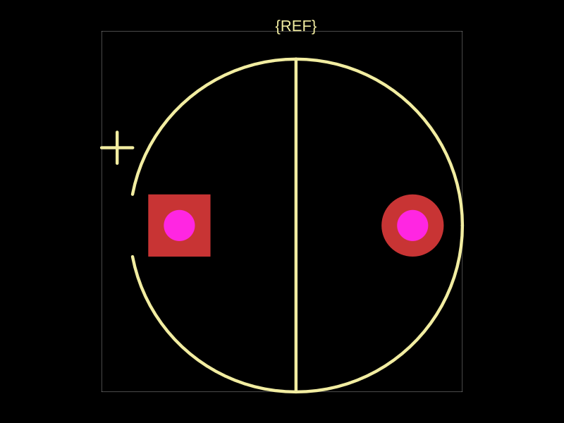
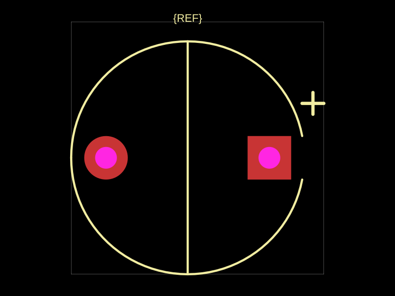

# Capacitor terminal mapping reproduction

`fp.string("electrolytic_positivepin2").circuitJson()` requests a capacitor with positive pin 2. At footprinter commit `4fa6ec9`, the option is ignored: the plus stays beside pin 1, and the square positive pad remains pin 1. After this fix, the plus, body cutout and square positive pad are on pin 2. Pin 1 and pin 2 retain their original left/right positions.

| Before | After |
| --- | --- |
|  |  |

The directory contains both SVGs and `F_SilkScreen.gbr` exports, generated with circuit-to-svg and circuit-json-to-gerber 0.0.113. Both Gerbers have 119 D01 drawing commands; the after file moves the two plus strokes to positive x and uses a 0.15 mm aperture. The body cutout is also mirrored. This proves the polarity mark reaches the manufacturing silkscreen, not just the viewer.

```ts
import { fp } from "@tscircuit/footprinter"
import { convertCircuitJsonToPcbSvg } from "circuit-to-svg"
import { convertCircuitJsonToGerberFiles } from "circuit-json-to-gerber"

const elements = fp.string("electrolytic_positivepin2").circuitJson()
const svg = convertCircuitJsonToPcbSvg(elements)
const topSilkscreen = convertCircuitJsonToGerberFiles(elements)["F_SilkScreen.gbr"]
```

Both tests in `tests/polarized-capacitors.test.ts` fail on the before implementation. Snapshots cover positive/negative mappings, polarized SMT capacitors, through-hole positive pad shape, nonpolarized controls, and disabled silkscreen. Invalid or coincident terminals are rejected.

[JLCPCB FAQ §10](https://jlcpcb.com/help/article/pcb-assembly-faqs-part-2) states: “Basically, we will judge them according to your silk layer.” It also says placement follows the silk by default when silk conflicts with CPL. The positive terminal mapping must match the datasheet and the connected net; this option does not rewrite connectivity or infer polarity from power/ground attributes.
