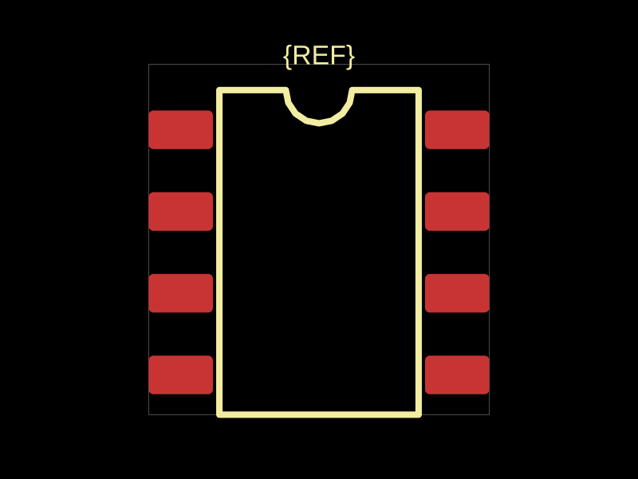
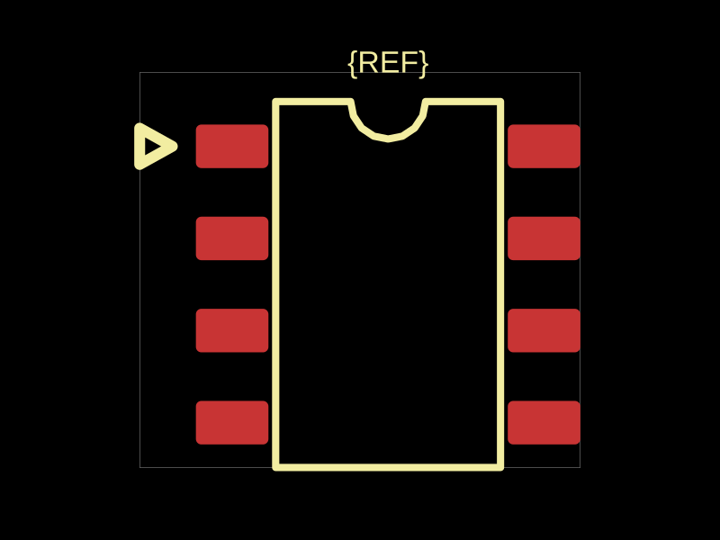

# Native pin-1 silkscreen reproduction

`fp.string("soic8").circuitJson()` at footprinter commit `4fa6ec9` has a package outline and notch but no explicit marker beside pin 1. After this change, a triangle points toward the actual pin-1 pad.

| Before | After |
| --- | --- |
|  |  |

The SVGs and top silkscreen Gerbers here were generated with circuit-to-svg and circuit-json-to-gerber 0.0.113. The before `F_SilkScreen.gbr` contains 35 D01 drawing commands; after contains 38. Three added segments draw the closed pin-1 triangle with a 0.15 mm aperture. This is printed silkscreen information, not a fabrication-note overlay.

```ts
const elements = fp.string("soic8").circuitJson()
const svg = convertCircuitJsonToPcbSvg(elements)
const silk = convertCircuitJsonToGerberFiles(elements)["F_SilkScreen.gbr"]
```

The shared native-footprint processing adds a marker to footprints with at least three pads and an identifiable pin 1 (`1`/`pin1`, or `A1` for coordinate-named packages), unless they already have an explicit pin-1 marker. Generic resistor/capacitor arrays and diode/LED packages are excluded from this new orientation pass. Existing pin-1 marks remain. Package notches alone do not suppress the explicit indicator.

The added triangle points inward from outside the copper and path outlines. Its stroke is 0.15 mm with at least 0.25 mm copper-edge clearance. Polygon pads, circular pads and plated-slot extents are supported. It rotates/translates with pads and is removed by `nosilkscreen`. Additional silkscreen space is needed beside densely placed packages; this change leaves copper and courtyards unchanged.

`tests/native-pin1-silkscreen.test.ts` checks 28 native IC, transistor and connector configurations, snapshots enabled/disabled silkscreen, and verifies clearance after SOIC orientation/origin transforms. The full existing test suite also exercises further native families. The existing raw-QFN roundtrip expectation now applies the same assembly postprocessing as the public API; copper and other generated geometry remain checked exactly.

The pre-existing default BGA marker was at the opposite Y corner from A1. The BGA generator now aligns it with the actual A1 corner for both default and explicit numbering. A regression checks and snapshots all four package origins.
