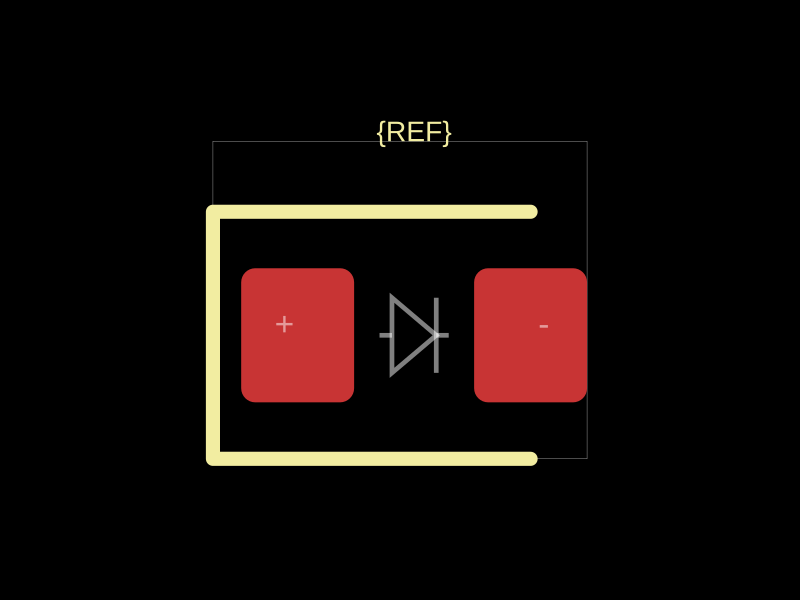
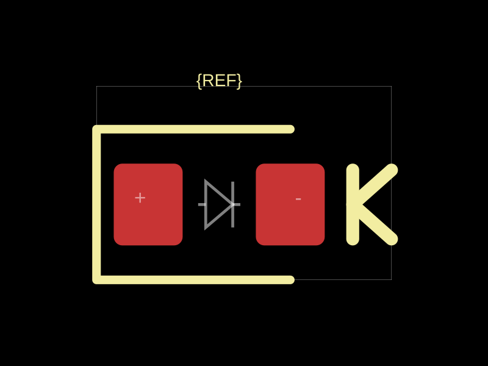

# Assembly polarity reproduction

JLCPCB's [PCB Assembly FAQs, Part 2, question 10](https://jlcpcb.com/help/article/pcb-assembly-faqs-part-2) says it uses silkscreen to judge polarity, asks the customer when markings are unclear, and follows silkscreen when it conflicts with the CPL file. Its [polarity and orientation guide](https://jlcpcb.com/help/article/component-polarity-and-orientation-identification-guide) explains the physical markings used for different components. Fabrication notes alone are therefore insufficient evidence of assembly orientation.

> “Basically, we will judge them according to your silk layer.”
>
> “When there is a mark point in the silkscreen layer, but it is inconsistent with your CPL file. In this case, we will make the placement according to the silkscreen layer by default.”

This reproduction is `fp.string("diode0603").circuitJson()`, rendered with `convertCircuitJsonToPcbSvg` and exported with `convertCircuitJsonToGerberFiles` from circuit-json-to-gerber 0.0.113. `before.svg` and `before-F_SilkScreen.gbr` use footprinter commit `4fa6ec9`; the after files use this implementation. No board outline is needed to reproduce footprint silkscreen.

| Before | After |
| --- | --- |
|  |  |

The top silkscreen Gerber contains 25 `D01*` drawing commands before and 28 after. The additional three segments draw the explicit K beside pin 2 with a circular 0.15 mm aperture. They are in `F_SilkScreen.gbr`, not merely an additional fabrication-note layer. The same existing Gerber silkscreen conversion handles both versions; this reproduction does not depend on changes to fabrication-note export.

Reproduce from a checkout of each revision:

```ts
import { fp } from "@tscircuit/footprinter"
import { convertCircuitJsonToPcbSvg } from "circuit-to-svg"
import { convertCircuitJsonToGerberFiles } from "circuit-json-to-gerber"

const elements = fp.string("diode0603").circuitJson()
const svg = convertCircuitJsonToPcbSvg(elements)
const topSilkscreen = convertCircuitJsonToGerberFiles(elements)["F_SilkScreen.gbr"]
```

The regression suite `tests/polarity-silkscreen.test.ts` fails 33 of its original 34 tests on the before revision. It checks all native diode families with their default and opposite pin mapping, copper clearance, RGB LED cathodes, transforms, capacitor polarity, and nonpolarized controls. The diode regression cases and SVG snapshots are in `tests/polarity-silkscreen.test.ts`; capacitor terminal mapping is handled by a separate fix. Additional axial diode coverage checks through-hole marks without assigning polarity to generic axial resistors.

A package marking is not sufficient to resolve an incorrectly assigned net or an incorrect manufacturer's pinout. Importers and component generators must pass the correct A/K or positive/negative mapping; generic power/ground attributes do not determine diode polarity.
